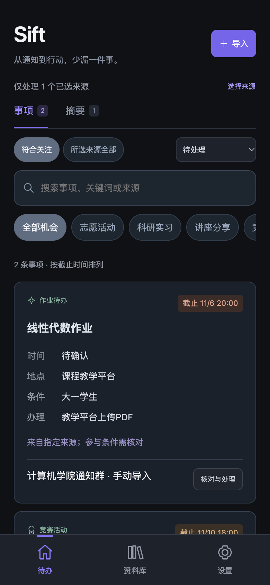

# Sift · 指定来源的信息与待办助手

帮助大学生整理指定来源的信息、提取待办，并找回收藏后忘记看的内容。手机优先的离线 HTML / CSS / JavaScript Demo，底部仅保留 **待办、资料库、设置**。

界面采用近黑、深灰与低饱和紫色，设计参考 [SuperBrain](https://github.com/sidinsearch/superbrain)。本仓库为独立 Demo。

[下载安卓试用包](dist/downloads/Sift-Demo-0.2.0.apk) · [安卓构建说明](android/README.md)



## 0.2 更新：根据第一轮29份答卷改进

本轮小样本调研促使产品优先完善事项提取、人工核对和低打扰回顾。答卷全部为大一、小样本便利招募，不据此推广到所有大学生；问卷原始答卷与管理资料不包含在公开仓库中。

- 指定来源白名单，在分析前拒绝未选择的来源；来源可独立设置机会/摘要。
- 结构化事项卡：活动、作业、校园事务；提取时间、地点、条件、报名/提交方式，可对照原文人工修改。
- 原文明确年级条件、关注关键词、排除词筛选；可查看“所选来源全部”核对被筛掉的事项。
- 导入按当前上海日期解释无年份日期和今天/明天/后天；只有日期不擅自补时刻。
- 已截止或取消的事项不导出新提醒。核对后下载 .ics，导入系统日历，由日历执行提前1小时的提醒。
- 粘贴整段平台分享文字快速收藏；自动分离URL，标题可留空。支持知乎、B站、小红书等来源识别。
- 收藏区分以后看、留作备查、暂时不需要，可记用途与下次查看日期；一次回顾3条，不要求读完。
- 机会提示和收藏回顾分开设置。导入提示即时生效；回顾到期仅在打开稍后看时显示。
- 既有收藏、搜索、分类、收藏集、图片、最近删除与恢复保留。新流程写入失败时回滚。

## 能力边界

**未接入真实微信、QQ、公众号采集、平台收藏同步、大模型、正文抓取、OCR、视频分析或后台推送。**填写来源名只建立本地标签，不连接账号。摘要是前四个不同非空段落的原文摘录，非语义分析。

机会汇总时刻仅保存偏好；网页关闭后不会运行或发送消息。日历导出不等于已导入，需要用户到日历应用确认。原文随日历文件导出，导入前会说明。

内容和设置仅保存在当前浏览器/安卓应用的 localStorage，网页和APK不共享、不跨设备同步。主动打开原链接时会访问对应网站；不自动读取链接。图片支持PNG/JPEG/WebP/GIF，最大1.5MB。

## 运行与检查

```bash
python3 -m http.server 4173 --bind 127.0.0.1 --directory dist
node test-core.cjs
node test-content.cjs
node test-scope.cjs
node test-workflow.cjs
node test-runtime.cjs
node test-android.cjs
```

`workflow-core.js` 是日期、条件和日历规则；`workflow.js` 实现本轮事项/收藏操作。`scope-core.js` 负责白名单。无安装和前端构建步骤。

安卓离线包和工具链说明见 [android/README.md](android/README.md)。APK版本0.2.0，同一开发签名可覆盖升级；尚未连接真机/模拟器验证。

## 快速体验

1. 在项目根目录运行上方的 Python 命令，打开 `http://127.0.0.1:4173/`。
2. 在“设置”中选择要处理的来源；未选择的来源不会进入分析。
3. 粘贴通知文字，核对提取出的事项，必要时修改时间、地点与条件。
4. 在“资料库”粘贴平台分享内容，选择以后看或留作备查。

Android 8.0 及以上可下载仓库中的 APK 后安装。试用包使用开发签名；首次安装可能需要在系统设置中允许该下载来源安装应用。新环境重建会生成自己的开发密钥，无法直接覆盖其他密钥签名的版本。

## 项目结构

- `dist/`：可直接运行的网页及演示下载页。
- `android/`：离线 WebView 容器、分享入口和构建脚本。
- `test-*.cjs`：规则、状态流转与 Android 桥接测试。
- `docs/`：演示截图。示例信息为虚构数据。

## 后续方向

- 在用户主动授权与平台允许的方式下探索信息导入。
- 用真实试用反馈验证提取准确性、截止日期与重复通知处理。
- 在清晰提示数据去向的前提下探索可选的模型摘要与同步。

目前未声明开源许可证；公开可见不等于已授予任意使用、修改或再分发的许可。
